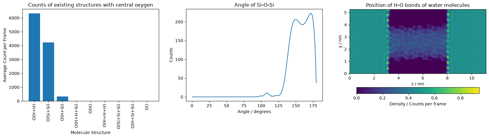

---

[](https://github.com/ProkopK/PoreReax/actions/workflows/ci.yml)
[](https://prokopk.github.io/PoreReax/)
[](https://github.com/ProkopK/PoreReax/actions/workflows/codeql.yml)
[](https://codecov.io/gh/ProkopK/PoreReax)
[](https://www.python.org/)
[](LICENSE)

<!-- start elevator-pitch -->

PoreReax is a Python package for analysing and setting up reactive molecular dynamics workflows based on ReaxFF and LAMMPS. Features include:

- Sample and post-process trajectories with different samplers
    * **Angle** distributions
    * **Charge** distributions
    * **Bond length** distributions
    * Existing **molecular structures**
    * **Density** of atoms, structures, bonds, and **reactions**
    * **Time evolution** of structures, bonds, and **reactions**
    * Radial distribution functions (**RDF**s)
- Plot sampled results with built-in plotting function
- Build simulation-ready LAMMPS input files from equilibrated GROMACS structures (`.gro`)
- Configure multi-stage ReaxFF workflows (for example NpT/NVT/NVE)

The idea of PoreReax analysis is to not focus on atoms or species, but rather on local structures. A structure is defined as a central atom or bond and their so called [bonding environment](https://prokopk.github.io/PoreReax/analysis/bonding_environment.html). This allows to analyse very large structures and the existence of functional groups in a system.

PoreReax can be used standalone for reactive analysis or integrated into the study of confined systems, i.e. pores created with [PoreMS](https://github.com/PoreMS/PoreMS).

<!-- end elevator-pitch -->

## Installation

<!-- start installation -->

PoreReax targets Python 3.12+ and is tested on Linux (x86_64) and macOS (arm64). The supported platforms require to run [OVITO](https://www.ovito.org/python-docs/) in combination with [multiprocessing](https://docs.python.org/3/library/multiprocessing.html) for analysis. Running the generated simulations requires a separate [LAMMPS](https://www.lammps.org/) installation with the REAXFF package.

Direct installation from github:

```bash
python -m pip install git+https://github.com/ProkopK/PoreReax.git
```

<!-- end installation -->

## Quickstart

<!-- start quickstart -->

### 1) Create a simulation workflow

To create a simulation from a GROMACS structure file (`.gro`), run the following code. This will generate `system.data`, `run_0.lmp`, `run_0.job`, and `ana.py`. Define your system matching to your `.gro` file and set a force field with `set_force_field()`. Run the simulation with LAMMPS and afterwards analyse the output with the `ana.py` script. 

<!-- start minimal simulation workflow -->

```python
from porereax import Simulate

# Set up a dictionary to translate GRO atom types to ReaxFF
# atom types as well as masses and charges
gro_lib = {"OM": "O", "OW": "O", "Si": "Si", "HW": "H", "MW": ""}
gro_charges = {"OM": -0.64, "OW": -1.1128, "Si": 1.28, "HW": 0.5564}
atom_masses = {"Si": 28.086, "O": 15.9994, "H": 2.016}

# Create a simulation object
sim = Simulate(gro_lib, gro_charges, atom_masses, structure_file="system.gro")
sim.set_force_field("reax.ffield")
sim.add_sim(type="nvt", nsteps=10000, temp=300)

# Generate the simulation files
sim.generate()
```

<!-- end minimal simulation workflow -->

### 2) Analyse simulation output

To run the analysis use the `ana.py` script generated in the previous step or run the following code. This code will sample the molecule structure, the Si-O-Si angle distribution and the 2D density of O-H bonds of water, and save the results in `molecule_structure.obj`, `angle_Si-O-Si.obj` and `density_water_2d_yz.obj`.

```python
from porereax import Sample

atom_lib = {"Si": 1, "O": 2, "H": 3}
atom_masses = {"Si": 28.086, "O": 15.9994, "H": 2.016}

sampler = Sample(atom_lib, atom_masses, "run_0.lammpstrj", "run_0.bonds")
sampler.add_molecule_structure_sampling("molecule_structure")
sampler.add_angle_sampling(
    "angle_Si-O-Si",
    atoms=[{"atom": "O", "bonds": ["Si", "Si"]}],
)
sampler.add_bond_density_sampling(
    name_out="density_water_2d_yz",
    bonds=[
        {"bond": "H-O", "bonds_B": ["H"]},
    ],
    dimension="Cartesian2D",
    direction="yz",
)
sampler.sample()
```

### 3) Visualise results

To plot the results, run the following code to plot the results of the previous step.

```python
from porereax import plot_data

plot_data("molecule_structure.obj")
plot_data("angle_Si-O-Si.obj")
plot_data("density_water_2d_yz.obj")
```

<!-- end quickstart -->




## Usage

A detailed usage guide can be found in the [documentation](https://prokopk.github.io/PoreReax/). It gives further information on
- [Simulation workflow](https://prokopk.github.io/PoreReax/simulation_workflow.html)
- [Analysis workflow](https://prokopk.github.io/PoreReax/analysis/analysis_workflow.html)
- [Visualisation](https://prokopk.github.io/PoreReax/analysis/visualization.html)
- [API reference](https://prokopk.github.io/PoreReax/api.html)

## Citation

If you use PoreReax in your research, please cite it using the metadata in [`CITATION.cff`](CITATION.cff) (GitHub's "Cite this repository" button).

## License

This project is licensed under GPL-3.0-only.
